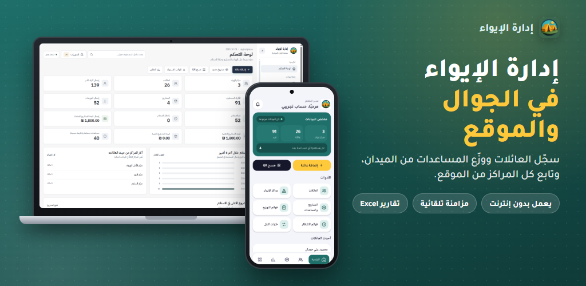
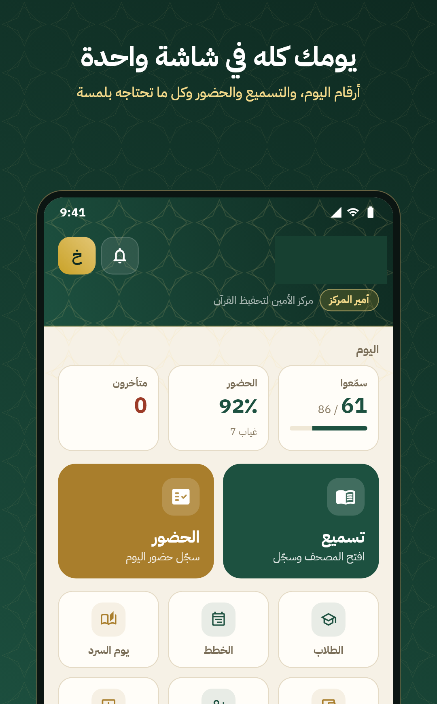
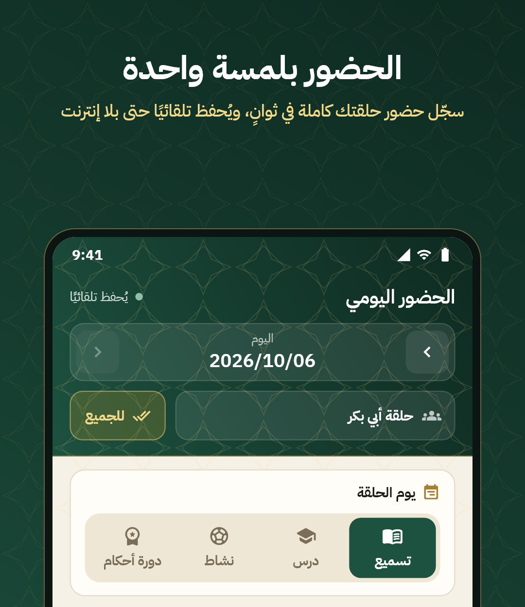

# Ahmed H. Alhelou

**Mobile Application Developer · Flutter · Dart · Android**

Based in Gaza, Palestine — building practical mobile and web solutions.

## About me

I'm a mobile app developer with hands-on experience in **Flutter, Dart, and Android**. I enjoy turning everyday challenges into software people can actually use — from humanitarian support systems to educational tools.

I also work on **Laravel-based backends**, using AI coding assistants as part of my development workflow. I care about clear interfaces, maintainable code, and reliable performance.

## Featured projects

### 01 — Iwaa | Shelter & Humanitarian Aid Management

A connected **mobile app and web dashboard** for organizing shelter information, household records, aid distributions, and reporting.

**Highlights:** Shelter and family management · Aid distribution tracking · Search and reporting · Excel exports · Offline-oriented field workflows

---

### 02 — Al Ameen | Qur'an Memorization & Learning Platform

A **Flutter mobile application and Laravel-backed system** that supports teachers and supervisors with memorization follow-up, attendance, daily reports, and educational stages.

  
  &nbsp;&nbsp;
  

**Highlights:** Memorization records · Attendance tracking · Daily reporting · Stage management · Offline-friendly attendance

## Skills & tools

| Area | Technologies |
| --- | --- |
| **Mobile** | Flutter · Dart · Android · Java |
| **Backend & APIs** | Laravel · PHP · REST APIs · AI-assisted development workflow |
| **Data** | Firebase · MySQL · SQLite |
| **Workflow** | Git · GitHub · Figma |

## Experience

- **Flutter Developer — Techshef:** Worked on mobile interfaces and API-connected applications.
- **Freelance Mobile App Developer:** Developed Android and cross-platform solutions for different project needs.

---

**Interested in collaborating or discussing a project?**

[LinkedIn](https://www.linkedin.com/in/ahmed-al-helou/) · [Portfolio](https://ahmedalhelou.netlify.app/) · [Linktree](https://linktr.ee/ahmedalhelou) · [Email](mailto:ahmedalhelou06@gmail.com)

Project previews only. Full application source code is kept in separate private repositories.

