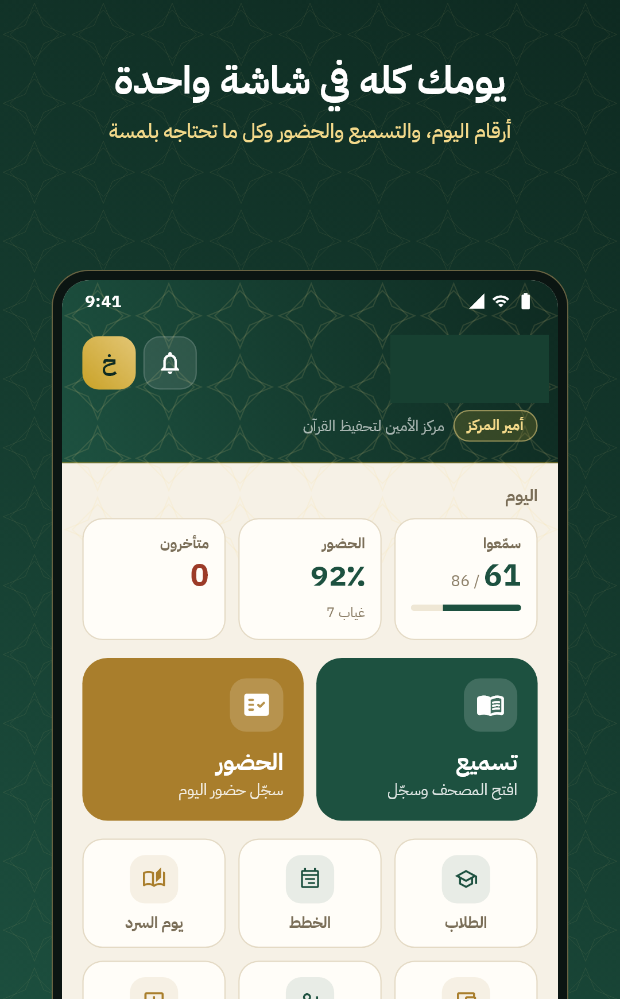
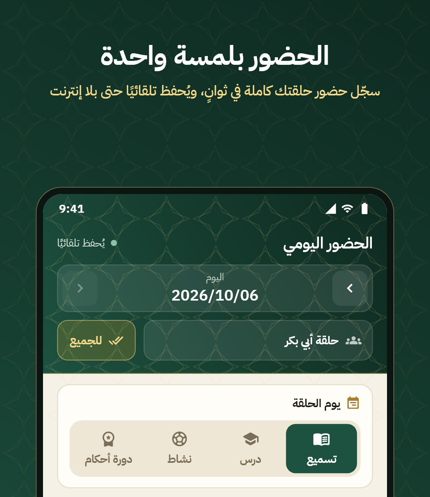

# Hi, I'm Ahmed H. Alhelou 👋

**Mobile Application Developer | Flutter · Dart · Android**  
📍 Gaza, Palestine

I build mobile applications and connected web tools that solve real problems. My strongest experience is in **Flutter, Dart, and Android**, from creating interfaces to working with APIs and databases. I also develop **Laravel-based backends with the support of AI coding tools**.

I care about software that is useful, straightforward to use, and built with attention to quality and performance.

## Tech & Tools

**Mobile:** Flutter, Dart, Android, Java  
**Backend & Web:** Laravel (AI-assisted development), PHP, REST APIs  
**Data & Services:** Firebase, MySQL, SQLite  
**Workflow:** Git, GitHub, Figma

## Featured Projects

### 🏠 Iwaa — Shelter & Humanitarian Aid Management

A mobile application and website built to support the management of shelters and humanitarian assistance.

**Links:** [Website](https://iwaa-app.com/) · [Project Showcase](https://github.com/Ahmedxd1/iwaa-showcase)

### 📖 Al Ameen — Qur'an Memorization & Learning

A mobile and web platform developed to support Qur'an memorization and learning activities.

 

**Links:** [Website](https://alameen-center.com/) · [Project Showcase](https://github.com/Ahmedxd1/alameen-showcase)

## Experience

**Flutter Developer — Techshef:** Worked on mobile apps, API integrations, and collaborative development.

**Freelance Mobile Developer:** Built Android and Flutter projects for different client needs.

## Let's Connect

[LinkedIn](https://www.linkedin.com/in/ahmed-al-helou/) · [Portfolio](https://ahmedalhelou.netlify.app/) · [Linktree](https://linktr.ee/ahmedalhelou) · [Email](mailto:ahmedalhelou06@gmail.com)

---

*Selected project previews are public. Full application source code is maintained in private repositories.*
