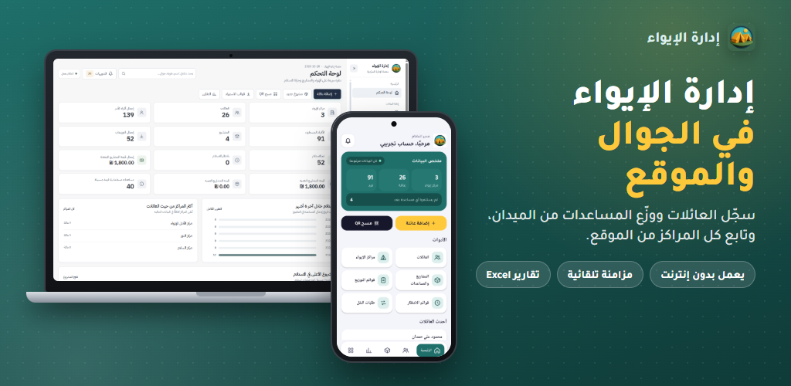
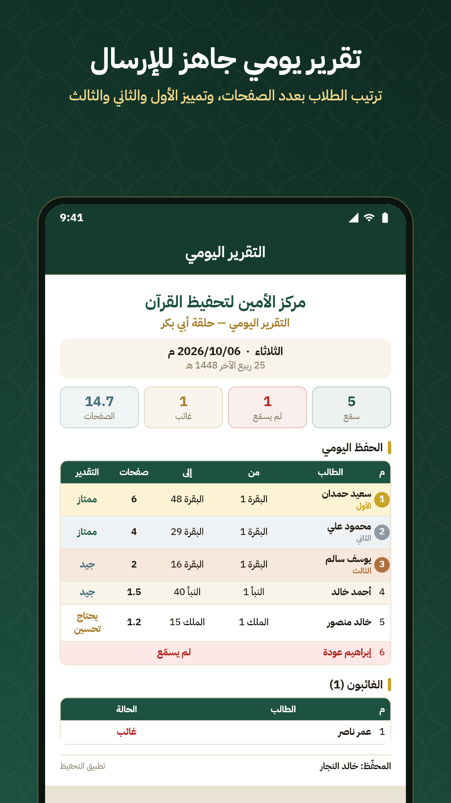
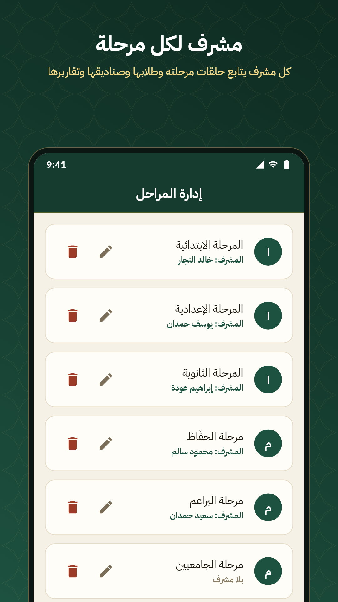

<h1 align="center">Hi, I'm Ahmed H. Alhelou 👋</h1>

  Mobile & Full-Stack Developer from Gaza, Palestine 
  Flutter • Dart • Android • Laravel

  
  
  
  

## About Me

I'm a mobile app developer with hands-on experience in **Flutter, Dart, and Android**, and a growing focus on **Laravel backend development**. I build practical software that solves real problems, with a strong interest in clean architecture, readable code, and smooth user experiences.

I also use **AI coding assistants** in my Laravel workflow to speed up development, improve implementation, and support problem-solving while building real-world applications.

## Tech Stack

- **Mobile:** Flutter, Dart, Android, Java
- **Backend:** Laravel, PHP, REST APIs
- **Database:** MySQL, SQLite, Firebase
- **Tools:** Git, GitHub, Figma, Postman

## Featured Projects

### Iwaa — Shelter & Humanitarian Aid Management System

A mobile and web-based system designed to support shelter operations and humanitarian aid management.

  

**Links:**
- 🌐 Website: https://iwaa-app.com/
- 📱 Android repository: https://github.com/Ahmedxd1/camps-app-android
- 💻 Web repository: https://github.com/Ahmedxd1/camps-app-web

---

### Al Ameen — Qur'an Memorization & Learning Platform

A mobile and web platform for Qur'an memorization, attendance tracking, daily reports, and educational management.

  
  
  
  

**Links:**
- 🌐 Website: https://alameen-center.com/
- 📱 Flutter repository: https://github.com/Ahmedxd1/Altahfeez_flutter_app
- ⚙️ Laravel repository: https://github.com/Ahmedxd1/tahfeez-backend-laravel

## What I'm Interested In

- Building real-world mobile applications
- Laravel backend development
- Education technology and humanitarian software
- Improving code quality and application performance

## Let's Connect

I'm open to meaningful collaborations, development opportunities, and conversations with other developers.

- LinkedIn: https://www.linkedin.com/in/ahmed-al-helou/
- Portfolio: https://ahmedalhelou.netlify.app
- Linktree: https://linktr.ee/ahmedalhelou
- Email: ahmedalhelou06@gmail.com
